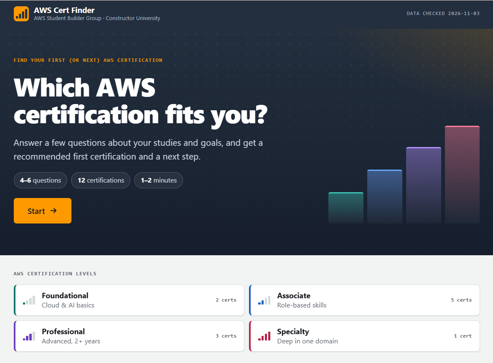
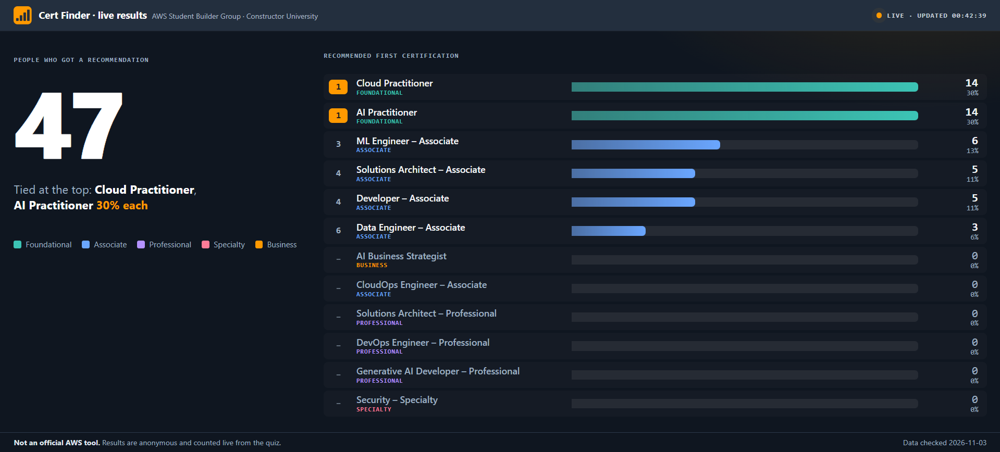
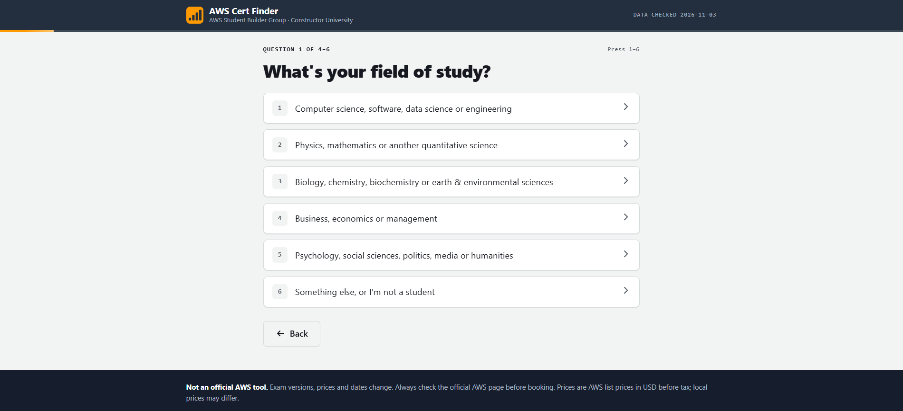
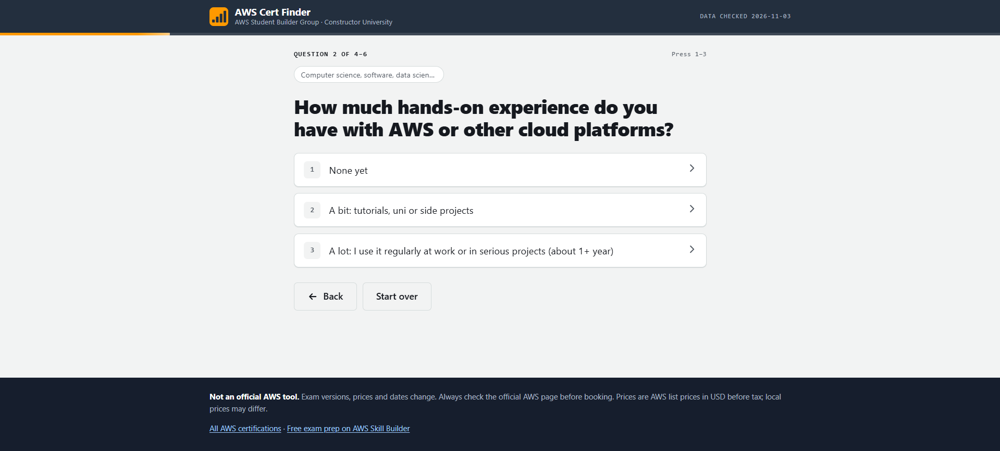
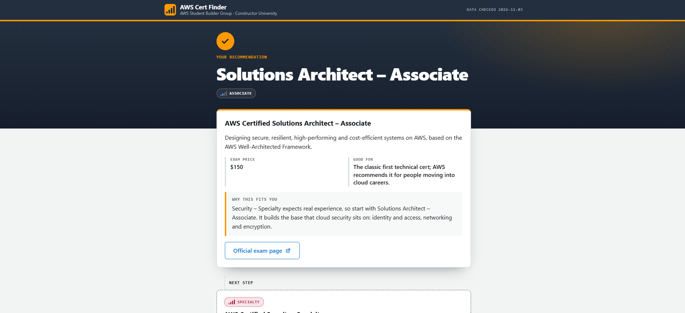
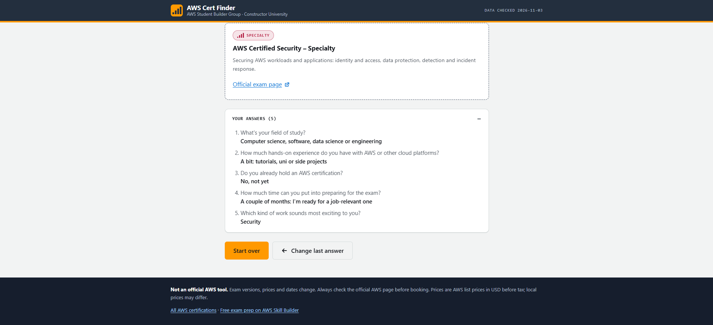

# AWS Cert Finder

An interactive quiz that recommends the right AWS certification to students of every major. Built for the first event of the AWS Student Builder Group at Constructor University (Bremen) on 6 November 2026.

**Live:** [aws-cert-finder.vercel.app](https://aws-cert-finder.vercel.app) · **Live results:** [aws-cert-finder.vercel.app/stats.html](https://aws-cert-finder.vercel.app/stats.html)



Visitors answer 4–6 questions about their field of study and goals, and get a recommended certification plus a next step. During the event, every result was counted live on AWS and shown on the projector.

## At the event

47 quizzes were completed during the event. Cloud Practitioner and AI Practitioner were the most common first recommendations (14 each, 30%), followed by ML Engineer – Associate (6), Solutions Architect – Associate and Developer – Associate (5 each), and Data Engineer – Associate (3).



## How the quiz works

The first question is the field of study, so students of every major get a path that fits them:



Each field has its own track, and every question after it changes the result:

| Field (first answer) | Track | Typical results |
|---|---|---|
| Computer science, software, data science, engineering | `q_tech_*`, `q_focus`, `q_data`, `q_ai`, `q_focus_pro` | All 12 certs, from Foundational to Professional |
| Physics, mathematics | `q_quant_*` | Cloud/AI Practitioner, or Solutions Architect, Data Engineer, ML Engineer |
| Biology, chemistry, biochemistry, earth & environment | `q_life_*` | Same as physics, with field-specific use cases |
| Business, economics, management | `q_biz_*` | Cloud Practitioner, AI Practitioner, AI Business Strategist; Data Engineer for data people |
| Psychology, social sciences, politics, media, humanities | `q_soc_*` | AI Practitioner, AI Business Strategist, Cloud Practitioner; Data/ML Engineer for data people |
| Something else / not a student | `q_experience` and the general questions | Any |

Anyone who answers that they already use the cloud regularly jumps to the technical track (`q_tech_cert_alot`), whatever their field.

While answering, a progress bar and the "Question 2 of 4–6" counter show how far along you are, earlier answers stay visible above the question, and the keys 1–6 pick an answer:



Each result shows the recommended certification, why it fits, and a next certification to aim for:



Previous answers stay visible below the result, with buttons to change the last one or start over:



Some nodes are shared between tracks (for example `q_time_data`, `q_sci_career` and the `r_research_*` results), so the "tree" is really a graph without loops. Changing a shared node changes it for every track that uses it.

## Architecture

```
visitor ──https──▶ Vercel (static: index.html, stats.html, config.js, data/tree.json)
   │
   └─ finished quiz ──POST /result──▶ AWS Lambda (Function URL) ──▶ DynamoDB (one counter per cert)
stats.html ──GET /stats every 3 s──▶ same Lambda
```

- **Questions & results:** `data/tree.json` (one file, no code): 40 questions and 51 results covering all 12 current AWS certifications
- **Site:** static, hosted on Vercel's free Hobby plan
- **Live stats:** AWS Lambda + DynamoDB, deployed with one CloudFormation template. Only one counter per certification is stored, no individual answers or personal data.
- **Optional:** the same template can also host the site on S3 + CloudFront, with the API on the same domain under `/api/` (see `docs/DEPLOY.md`)

```
index.html            the quiz page
stats.html            presenter view: live counts, refreshes every 3 s
config.js             settings: stats API URL (empty = stats off)
assets/               favicon, apple-touch-icon and the link preview image
data/tree.json        all questions, answers, results and cert info
scripts/
  validate_tree.py    checks tree.json (dead ends, loops, missing fields); --paths prints every path
  dev_server.py       local server + fake stats API, no AWS needed
  deploy_site.sh      uploads the site to S3 and refreshes CloudFront (AWS CLI, optional setup)
backend/
  handler.py          Lambda code (source of truth)
  template.yaml       CloudFormation: DynamoDB + Lambda stats API; optional S3 + CloudFront site
  sync_template.py    copies handler.py into template.yaml
  tests/              pytest + moto (mocked DynamoDB)
docs/
  DEPLOY.md           step-by-step deploy, reset and teardown
  images/             screenshots for this README
```

## Team

- **Umid Huseynov:** questions and decision logic, AWS backend (Lambda, DynamoDB, CloudFormation), tests and CI
- **Riyad:** frontend (design, mobile layout, progress bar, kiosk mode, link previews, stats page)

## Run it locally

```bash
python scripts/dev_server.py
# open http://localhost:8000          (quiz)
# open http://localhost:8000/stats.html (live stats)
```

The dev server also serves a fake stats API at `/api/`. To try the stats flow locally, set `statsApiUrl: "/api/"` in `config.js` (and set it back before pushing). Opening `index.html` straight from disk won't work because browsers block `fetch()` of local files; use the server.

## Event day

- **Kiosk:** open `/?kiosk` on a shared screen. The quiz goes back to the start after a minute without a tap, with a 10 second countdown first. Without `?kiosk` nothing resets, so phones are not affected. Links to the exam pages show as plain text in kiosk mode.
- **Projector:** open `stats.html` fullscreen and turn off sleep on the laptop. If the rows show ids like `saa` instead of names, reload the page.
- **Reset the counts:** right before the event, delete all items in the DynamoDB table (`docs/DEPLOY.md`, section 4), so the projector starts at 0.
- **Link preview:** the `og:` and `twitter:` tags in `index.html` use the full site URL. If the domain changes, update `og:url`, `og:image` and `twitter:image`.
- **Local testing:** `config.js` points at the real stats API, so a finished quiz on localhost gets counted. Set `statsApiUrl` to `"/api/"` while testing with `scripts/dev_server.py` and don't commit it.

## For the frontend: the data contract

The frontend only **walks the tree**. All logic lives in `tree.json`.

```jsonc
{
  "start": "q_field",                    // first node to show
  "meta": { "title", "subtitle", "updated", "disclaimer", "price_note", "resources": [{ "label", "url" }] },
  "nodes": {
    "q_experience": {
      "type": "question",
      "text": "How much hands-on experience ...?",
      "options": [ { "label": "None yet ...", "next": "q_background" } ]   // 2–6 options
    },
    "r_saa": {
      "type": "result",
      "primary": "saa",                   // key in certs: show this as the recommendation
      "next_step": "sap",                 // optional: what to do after
      "reason": "Why this fits the visitor (1–3 sentences)"
    }
  },
  "certs": {
    "saa": {
      "name": "AWS Certified Solutions Architect – Associate",
      "short_name": "Solutions Architect – Associate",
      "level": "Associate",               // Foundational | Associate | Professional | Specialty | Business
      "summary": "...", "good_for": "...",
      "price_usd": 150,                   // or null (e.g. beta exams)
      "status": "active",                 // active | beta
      "note": "optional, e.g. exam version change",
      "url": "https://aws.amazon.com/certification/..."
    }
  }
}
```

Walking it:

1. Load `data/tree.json`, show `nodes[start]`.
2. Question node → show `text` and one button per option. On click, push `{node, answer}` to a history stack and go to `option.next`.
3. Result node → show `certs[primary]` (name, level, summary, price, link), the `reason`, and `certs[next_step]` if present.
4. Back = pop the history stack. Start over = clear it.

Rules worth keeping:

- Don't hard-code questions or exam codes in the frontend. Exam versions change (several do in Nov–Dec 2026), so the data has names, not codes.
- Show `meta.disclaimer`: this is not an official AWS tool.
- The colors follow the AWS style (dark navy, orange), but never use AWS logos or the "Powered by AWS" mark.

### Live stats API

When a visitor reaches a result, send **one** request per quiz run:

```js
fetch(STATS_URL + "result", {
  method: "POST",
  headers: { "Content-Type": "text/plain;charset=UTF-8" },  // no CORS preflight; body is still JSON
  body: JSON.stringify({ cert: "saa" }),   // the result's primary cert id
  keepalive: true
}).catch(() => {});                        // never block or show an error to the visitor
```

| Call | Response |
|---|---|
| `POST /result` `{"cert": "<id>"}` | `200 {"ok": true}` · `400` unknown id or bad JSON · `413` body > 1 KB |
| `GET /stats` | `200 {"total": 12, "counts": [{"cert": "saa", "count": 5}, ...]}` sorted by count, every cert included (zeros too) |

`STATS_URL` comes from `config.js` (`statsApiUrl`) and ends with `/`. When it's empty, skip the call. Keep the `text/plain` content type: `application/json` would trigger a CORS preflight, which some browsers don't allow together with `keepalive`. `index.html` shows the full pattern if you want to copy it.

## Editing questions

1. Edit `data/tree.json` (keep ids: questions start with `q_`, results with `r_`).
2. Run `python scripts/validate_tree.py --paths` and read the printed paths. It fails on broken links, loops, missing fields, and warns about unreachable nodes or unused certs.
3. If you add or remove a cert id, also update `CertIds` in the CloudFormation stack (see `docs/DEPLOY.md`), or the API will reject it.

Cert facts were checked against the official AWS exam guide list on 2026-11-03: the Machine Learning – Specialty is retired, SysOps Administrator is now CloudOps Engineer, AI Business Strategist is in beta, and Advanced Networking – Specialty is left out because it retires at the end of 2026.

## Tests

```bash
pip install -r backend/requirements-dev.txt
python scripts/validate_tree.py
python backend/sync_template.py --check
cfn-lint backend/template.yaml
pytest backend/tests
```

GitHub Actions runs the same checks on every push (`.github/workflows/checks.yml`). The backend tests run against a mocked DynamoDB (moto), so CI needs no AWS credentials; the deployed stack was smoke-tested by hand.

## Deploying

**Site: Vercel (static, no build step).**

1. [vercel.com](https://vercel.com) → **Continue with GitHub**.
2. **Add New → Project** → import this repo.
3. **Framework Preset: Other**, leave Build and Output settings empty → **Deploy**.
4. Every push to `main` redeploys automatically. `.vercelignore` keeps `backend/`, `scripts/` and `docs/` off the site.

**Live stats: AWS.** Deploy `backend/template.yaml` with CloudFormation (`CreateWebsite` = `no`) as described in `docs/DEPLOY.md`, then put the stack's **StatsApiUrl** output in `config.js`. `AllowedOrigin` is `*`, so the live site, Vercel preview links and local tests can all reach it.

To stop the stats, delete the stack (`docs/DEPLOY.md`, "After the event") and set `statsApiUrl` back to `""`.
